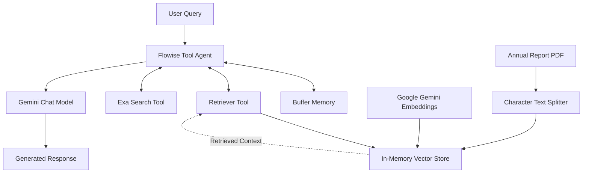

# System Architecture — Elevate Real Estate RAG Chatbot

## 1. Overview

Elevate Real Estate RAG Chatbot is a visual AI application built with Flowise that combines retrieval-augmented generation (RAG), LLM-based tool selection, document-grounded question answering, and external web search.

The system is designed around a fictional Egyptian residential real estate brokerage. It can answer questions using the company's 2024 annual report, handle general questions, and use Exa Search as an external information source when appropriate.

The architecture combines two main capabilities:

- **Private knowledge retrieval:** Semantic retrieval over the annual report PDF.
- **Tool-augmented question answering:** A Tool Agent that can use the configured retrieval and web search tools.

## 2. High-Level Architecture

The diagram illustrates the major components and their logical relationships. The exported Flowise JSON should be used to verify the precise node connections and execution order.

## 3. Technology Stack

| Component | Technology | Responsibility |
|---|---|---|
| AI orchestration | Flowise | Visual workflow and node orchestration |
| Agent | Tool Agent | Selects and invokes configured tools |
| Chat model | Google Gemini | Language generation and agent reasoning |
| Chat model configuration | `gemini-3.1-flash-lite-preview` | Model shown in the workflow screenshot |
| Embeddings | Google Gemini Embeddings | Converts document content into vector representations |
| Embedding model | `gemini-embedding-001` | Embedding model shown in the workflow screenshot |
| Document loader | PDF File | Loads the annual report |
| Text splitting | Character Text Splitter | Splits text into chunks |
| Vector storage | In-Memory Vector Store | Stores vectors for semantic retrieval |
| Retrieval tool | Retriever Tool | Exposes retrieved document information to the agent |
| Web search | Exa Search | Provides access to external web information |
| Conversation memory | Buffer Memory | Maintains conversational context |

Model availability and compatibility depend on the Flowise version and provider configuration.

## 4. Document Ingestion Pipeline

The annual report is processed through the following logical stages.

### 4.1 PDF loading

The PDF File node loads the Elevate Real Estate Annual Report 2024.

The report includes company information, financial performance, property segments, regional performance, leadership, risk factors, and strategic initiatives.

### 4.2 Text splitting

The Character Text Splitter prepares the extracted document content for retrieval.

The visible configuration is:

| Parameter | Value |
|---|---:|
| Chunk size | 1,000 characters |
| Chunk overlap | 200 characters |
| Custom separator | `""` as displayed in the node |

Chunk overlap helps preserve contextual continuity between adjacent chunks. The separator and splitting behavior should be verified against the actual Flowise node configuration.

### 4.3 Embedding generation

Google Gemini Embeddings uses `gemini-embedding-001` to generate vector representations of document chunks.

These vectors allow semantically related questions and document passages to be matched even when they do not share identical wording.

### 4.4 Vector storage

The In-Memory Vector Store stores the document vectors and associated content for similarity-based retrieval.

The visible Top K setting is `4`, meaning the retriever is configured to return up to four relevant results where supported by the retrieval implementation.

Because the store is in memory, persistence across restarts is not guaranteed. The indexing lifecycle depends on the Flowise configuration and whether the document-ingestion path is executed again.

## 5. Retrieval and Tool Integration

### 5.1 Retriever Tool

The Retriever Tool exposes the vector-store retriever as a tool available to the agent.

Its visible description instructs it to retrieve relevant information from the connected knowledge base based on the user's question.

The Return Source Documents setting is enabled in the screenshot. This supports returning retrieved document information from the retriever; it does not by itself guarantee that every final answer displays user-facing citations.

### 5.2 Exa Search

Exa Search is connected as a separate tool to the Tool Agent.

It allows the workflow to obtain external information rather than relying exclusively on the annual report or the model's internal knowledge.

For questions about current market prices or other information absent from the fictional report, external search is an appropriate capability to test.

Actual tool selection depends on the agent's reasoning, tool descriptions, model behavior, and available search results. The architecture does not guarantee that every external-information question will trigger Exa.

## 6. Agent and Conversation Processing

### 6.1 Tool Agent

The Tool Agent acts as the central orchestration component. Its connected inputs include:

- Google Gemini chat model
- Retriever Tool
- Exa Search
- Buffer Memory

For an incoming query, the agent can determine whether document retrieval, external search, or a direct language-model response is appropriate.

The workflow is tool-augmented and agentic because the model can select and invoke tools. This does not necessarily mean that it contains multiple independent agents.

### 6.2 Chat model

The ChatGoogleGenerativeAI node uses the model shown in the workflow screenshot, `gemini-3.1-flash-lite-preview`, with a configured temperature of `0.9`.

The chat model supports natural-language response generation and the reasoning required for tool calling.

The temperature setting influences generation variability; it does not measure factual accuracy.

### 6.3 Buffer Memory

Buffer Memory is connected to the Tool Agent to support conversational context across turns, subject to the Flowise memory configuration and session handling.

Memory persistence, isolation between users, and behavior across application restarts must be verified before making deployment claims.

## 7. Query Lifecycle

A typical interaction follows this logical sequence:

1. The user submits a question through the Flowise chatbot interface.
2. The Tool Agent receives the query and available conversation context.
3. The agent determines whether to invoke the Retriever Tool, Exa Search, or respond directly.
4. If retrieval is selected, the vector-store retriever returns relevant annual-report content.
5. If external search is selected, Exa Search provides external results.
6. The agent uses the available information to formulate a response.
7. The response is returned to the user through the chatbot interface.

The actual tool-call sequence can vary by question.

## 8. Example: Document-Grounded Question

**Question:** What was Elevate Real Estate's total sales value in 2024, and how much did it grow compared with 2023?

The annual report states:

- 2024 total sales value: EGP 2.85 billion
- 2023 total sales value: EGP 2.10 billion
- Year-over-year growth: 35.7%

The chatbot returned these values in its demonstrated response, along with retriever source-document indicators.

This is an example of document-grounded answering. A single successful response demonstrates functionality for this test case but is not a comprehensive retrieval or factuality evaluation.

## 9. Security and Operational Considerations

- Store API credentials securely using Flowise's supported credential management.
- Never commit API keys, access tokens, or private environment files.
- Review exported workflow JSON for sensitive configuration before publishing.
- Protect the Flowise instance with appropriate authentication and network controls.
- Verify session isolation when deploying conversation memory for multiple users.
- Account for Gemini and Exa quotas, rate limits, availability, and model changes.
- Consider a persistent vector database if document indexing must survive restarts.
- Verify the source-document licensing before redistributing PDFs.

## 10. Limitations

- In-memory vector storage may require re-indexing after restarts.
- PDF text extraction and chunk boundaries can affect retrieval quality.
- Agent tool selection can be inconsistent for ambiguous questions.
- External search results may be incomplete, stale, or irrelevant.
- Buffer Memory does not automatically provide durable conversation storage.
- A working demonstration does not establish production readiness.

## 11. Potential Improvements

- Add a persistent vector database.
- Establish a repeatable RAG evaluation dataset.
- Measure retrieval relevance and answer groundedness.
- Improve source attribution in the final responses.
- Add structured logging, latency tracking, and error handling.
- Test agent routing across document, general-knowledge, and external-search questions.
- Document a reproducible Docker deployment if the complete configuration is available.

## 12. Summary

The Elevate Real Estate chatbot demonstrates how Flowise can combine document ingestion, semantic retrieval, a Gemini-powered Tool Agent, conversational memory, and external web search into a single question-answering workflow.

The main engineering concepts illustrated are RAG pipeline design, embedding-based retrieval, tool calling, model orchestration, and the operational trade-offs of in-memory vector storage.

**Project type:** Retrieval-Augmented Generation and tool-augmented AI  
**Orchestration:** Flowise  
**Primary model provider:** Google Gemini  
**Retrieval source:** Fictional real estate annual report  
**External search:** Exa Search